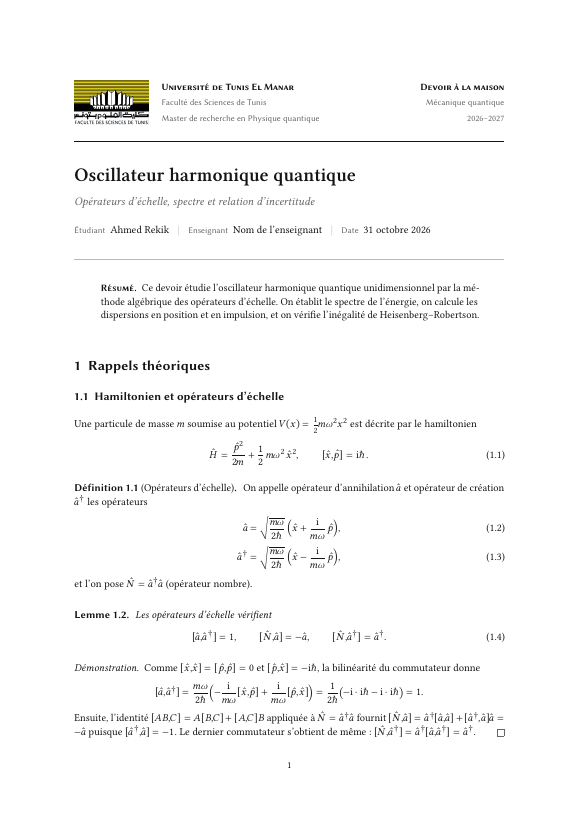
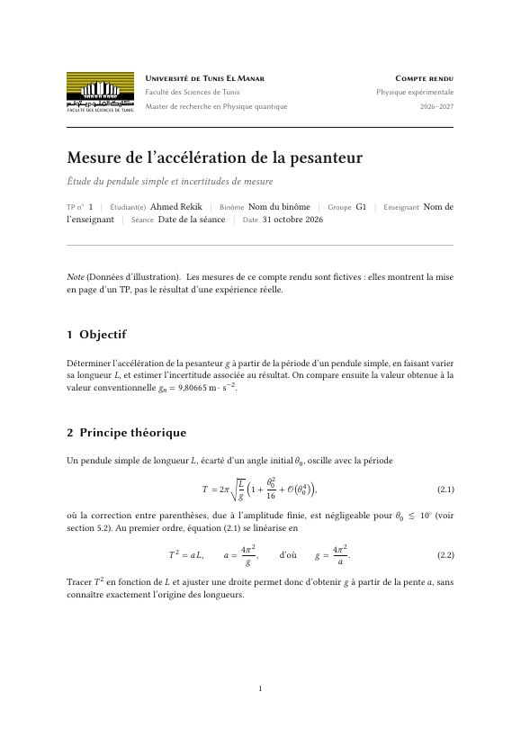
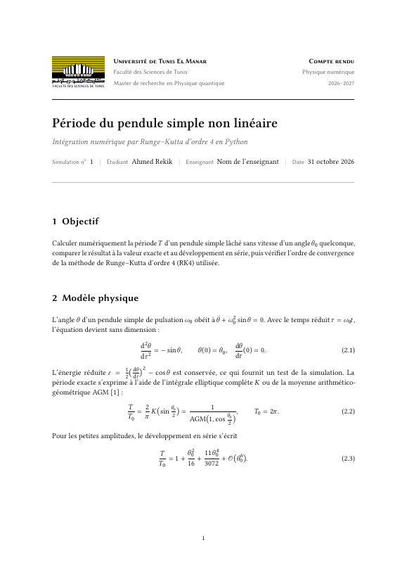

# Template LaTeX physique : devoirs, TP, simulations numériques

A4, 11 pt, français. Polices **Libertinus** réglées pour LuaLaTeX (gras Semibold, intégrales inclinées, vecteurs en gras droit). Texte **entièrement noir et gris** :
aucune couleur de thème. LuaLaTeX + Biber, géré automatiquement.
Un aide-mémoire d'une page de toutes les commandes : **`aide-memoire.pdf`**.

> **English summary.** A LaTeX template (LuaLaTeX + Biber, A4, 11 pt, French by default) for physics
> **assignments**, **lab reports** and **numerical-simulation reports** (Python → CSV → PDF),
> with Libertinus fonts, a consistent title banner, theorem/exercise environments and one-command
> compilation (`latexmk`). Pick a template below, edit the `\docsetup{…}` block, press compile.
> Licensed under MIT (the faculty logo is excluded, see `LICENSE`). If you use it, please cite it
> (see `CITATION.cff`).

## Aperçu / Preview

| Devoir / Assignment | Compte rendu de TP / Lab report | Simulation |
|:---:|:---:|:---:|
| [](exemple-A-assignment.pdf) | [](exemple-B-tp.pdf) | [](exemple-C-simulation.pdf) |

PDF complets : [`exemple-A-assignment.pdf`](exemple-A-assignment.pdf) ·
[`exemple-B-tp.pdf`](exemple-B-tp.pdf) · [`exemple-C-simulation.pdf`](exemple-C-simulation.pdf) ·
[`aide-memoire.pdf`](aide-memoire.pdf)

**Prérequis / Requirements :** MiKTeX or TeX Live (LuaLaTeX, Biber, latexmk), fonts *Libertinus*, Python 3 (simulation example only).

---

## 1. Ce que je fais, concrètement

**Règle d'or : on compile UN seul fichier, celui qu'on a ouvert et qu'on édite**
(`main.tex`, `exemple-B-tp.tex`…). Jamais `config.tex`, ni les fichiers de `style/`
ou de `sections/`.

### Écrire un nouveau devoir / TP / rapport

1. Copier un modèle et le renommer :

   | Je veux… | Je copie… |
   |---|---|
   | un devoir de physique théorique | `exemple-A-assignment.tex` |
   | un compte rendu de TP | `exemple-B-tp.tex` |
   | un compte rendu de simulation (Python) | `exemple-C-simulation.tex` |
   | partir d'une page presque vide | `main.tex` |

2. Ouvrir la copie dans TeXstudio. En haut du fichier, modifier le bloc `\docsetup{ … }`
   (titre, cours, enseignant, date…). C'est la **seule** partie à régler.
3. Écrire le contenu. Appuyer sur **F5** : un seul appel compile tout (LuaLaTeX, Biber,
   relances nécessaires) et ouvre le PDF.

### Compiler sans TeXstudio

Double-clic sur **`compiler.bat`** (compile `main.tex`), ou glisser un fichier `.tex`
dessus, ou en ligne de commande :

```powershell
.\compiler.bat exemple-B-tp
.\compiler.bat nettoyer        # supprime les fichiers auxiliaires
```

Le script affiche à la fin les problèmes éventuels (références manquantes, avertissements,
boîtes trop larges), puis ouvre le PDF.

### Simulation numérique en Python : deux étapes, dans cet ordre

```powershell
python code/simulation.py          # 1) calcule et écrit data/*.csv
.\compiler.bat exemple-C-simulation   # 2) le PDF lit ces CSV
```

Refaire l'étape 1 chaque fois que le code ou ses paramètres changent : tableaux, courbes et
valeurs citées dans le texte se mettent à jour tout seuls à l'étape 2.

---

## 2. Réglage unique dans TeXstudio

Rien à faire en principe : chaque fichier contient `% !TeX TXS-program:compile = txs:///latexmk`,
et **F5** lance donc latexmk, qui est réglé (fichier `latexmkrc`) pour utiliser LuaLaTeX et Biber.

Si F5 ne fait pas ce qu'il faut, une fois pour toutes : **Options → Configurer TeXstudio →
Compilation** → *Compilateur par défaut* = **latexmk** (et *Outil bibliographique* = Biber).
Ne rajoutez pas l'option `-pdf` ou pdfLaTeX à la main : `latexmkrc` impose LuaLaTeX de toute façon.

---

## 3. Où est quoi

```
.
├── compiler.bat                double-clic : compile + vérifie + ouvre le PDF
├── aide-memoire.pdf / .tex     toutes les commandes sur une page
├── config.tex                  VOTRE identité (nom, université, logo) : une seule fois
├── main.tex                    point de départ presque vide
├── exemple-A-assignment.tex    modèle : devoir            (contenu : sections/exemple-A.tex)
├── exemple-B-tp.tex            modèle : compte rendu de TP (contenu : sections/exemple-B.tex)
├── exemple-C-simulation.tex    modèle : simulation Python (contenu : sections/exemple-C.tex)
├── references.bib              bibliographie
├── latexmkrc                   réglages de compilation (ne pas toucher)
├── style/                      préambule, macros, titre — NE PAS MODIFIER pour un devoir
├── logo/                       LOGO_FST.png (original couleur), LOGO_FST_gris.png (version grise)
├── code/                       programmes Python / MATLAB, insérés dans le PDF tels quels
├── data/                       fichiers CSV produits par les programmes
├── figures/                    images (PDF, PNG, JPG)
└── sections/                   contenu des exemples (et vos propres fichiers de chapitres)
```

---

## 4. Les réglages d'un document : `\docsetup`

```latex
\docsetup{
  type       = tp,                 % assignment | tp | simulation | rapport
  numero     = {2},                % TP n° 2
  cours      = {Physique expérimentale},
  enseignant = {Nom},
  titre      = {Titre du document},
  soustitre  = {},
  binome     = {Nom du binôme},    % tp seulement (aussi groupe, seance)
  % brouillon  = true,             % filigrane « BROUILLON »
  % titlestyle = page,             % page de titre complète
}
```

- Une clé vide ou absente est omise du titre. Lignes vides et commentaires `%` autorisés.
- L'**identité** (`etudiant`, `universite`, `faculte`, `departement`, `filiere`, `annee`, `logo`)
  est dans `config.tex` : à régler une seule fois pour tous vos documents.
- **Logo** : `logo = {logo/LOGO_FST.png}`. Pour le retirer : `logo = {}` ; si le fichier est
  introuvable, un avertissement s'affiche et le titre est composé sans logo.
- **Titre compact** : en-tête sur une bande (logo, institution, type de document / cours /
  année), titre, une ligne d'informations. `titlestyle = page` donne une page de titre complète.

## 5. Contenu : le minimum à connaître

| Besoin | Commande |
|---|---|
| Section | `\section{…}`, `\subsection{…}` |
| Section de TP | `\begin{objectif} … \end{objectif}` (aussi `principe`, `protocole`, `resultats`, `analyse`, `conclusion`) |
| Section de simulation | `modele`, `methode`, `implementation`, `validation` |
| Équation numérotée + référence | `\begin{equation} … \label{eq:x} \end{equation}` puis `\cref{eq:x}` |
| Théorème, définition, preuve | `theoreme`, `definition`, `lemme`, `demonstration`… |
| Devoir | `exercice`, `question[3 pts]`, `solution` |
| Image | `\includegraphics{nom}` (dossier `figures/`) dans un `figure` + `\caption` + `\label` |
| Unités | `\qty{9.81}{m.s^{-2}}`, `\qtyerr{9.75}{0.06}{m.s^{-2}}` |
| Citation | `\cite{cle}` ; entrée dans `references.bib` |

Tout le reste (macros de physique, Dirac, dérivées, etc.) : voir **`aide-memoire.pdf`**.

### Code et données (nouveau)

```latex
% Code lu depuis le fichier réel (toujours à jour), coloré selon le langage :
\codefile[first-line=22, last-line=47]{Python}{code/simulation.py}{Mon programme}{prog:a}
%   langages : Python, C, Matlab, OCaml, SQL ; sans [..] : le fichier entier

% Tableau lu depuis un CSV :
\pgfplotstabletypeset[fixed, fixed zerofill,
    columns/theta0/.style={column name={$\theta_0$}, int detect}]{data/resultats.csv}

% Courbe lue depuis un CSV (dans un axis) :
\addplot table[x=theta0, y=T_rk4, col sep=comma]{data/periode.csv};
```

`\cref{prog:a}` donne « programme 1 ». Coloration syntaxique (mots-clés, fonctions
prédéfinies, chaînes, commentaires, nombres) assurée par le package `piton`, sans
`shell-escape`. Pour du code écrit à la main : `\begin{Piton}[language=Matlab] … \end{Piton}`.
Le modèle complet est `exemple-C-simulation.tex` ; il contient aussi l'extraction d'une valeur
du CSV directement dans une phrase (`\pgfplotstablegetelem`).

---

### Titre, en-têtes, notes, légendes

- **Bandeau du titre** : le logo reste à gauche ; à sa droite, deux blocs de texte construits à l'identique
  (3 lignes, mêmes corps) et centrés sur la hauteur du logo, donc au même niveau : à gauche l'institution
  (université, faculté, formation), à droite le type de document **court** (« Compte rendu », « Rapport »,
  « Devoir à la maison »), le cours et l'année. Le numéro du TP figure dans la ligne d'informations.
- **En-tête** (toutes les pages sauf la première) : à gauche le titre court en *italique gris*, à droite le cours
  en romain noir, filet gris fin dessous ; **numéro de page centré en pied** (première page comprise).
- **Notes de bas de page** : `\footnote{…}` (marque en exposant, petit filet gris). Dans un tableau :
  `threeparttable`, `\tnote{a}` dans la cellule et `\begin{tablenotes} \item[a] … \end{tablenotes}`
  (exemple : `sections/exemple-B.tex`). Crédit d'une figure ou d'un tableau : `\source{…}`.
- **Légendes aux normes éditoriales** : « **Figure 1.** Légende. » ; figure : légende **sous** l'image ;
  tableau et programme : légende **au-dessus** ; étiquette en gras noir, texte courant, corps un cran
  plus petit, légende d'une ligne centrée, de plusieurs lignes justifiée ; sous-figures (a), (b).

---

## 6. Ce qui a changé par rapport à la première version

- **Couleurs** : tout le texte est noir (informations secondaires en gris) : titres, gras, liens, citations,
  puces, remarques, filets. Aucune couleur de thème. Les seules couleurs du document sont celles de vos
  **images importées**, qui sont conservées à l'identique (jamais converties en gris), et du logo.
  Les courbes de l'exemple (`DataBlue`, `DataRed`) et la coloration syntaxique du code (mots-clés, chaînes,
  commentaires, nombres) sont définies au début de `style/preamble.tex` ; pour un code entièrement noir,
  remplacer les couleurs `Code…` par `TextColor`. Pour réintroduire un accent partout (liens, puces,
  filets, remarques), changer la ligne `\colorlet{AccentColor}{TextColor}`.
- **Titre** : bloc compact (≈ 4 cm au lieu de ≈ 7 cm) avec logo ; plus de grand tableau d'informations.
- **Structure** : `style/` (ne pas toucher), `config.tex` réduit à l'identité, réglages du
  document au début de chaque fichier ; `compiler.bat` et F5 font tout.
- **Défauts corrigés** :
  - lignes vides dans `\docsetup{…}` : acceptées ;
  - virgule décimale en mode math : `$0,5$` → 0,5 ; `$a, b$` reste une énumération ;
  - figure dans une `solution` : `\captionof{figure}{…}` fonctionne ;
  - tableaux, légendes, « Tableau » (et non « Table »), code coloré par langage ;
  - plus d'avertissement « shapes not available » (police de code Latin Modern Mono).
- **Nouveautés** : type `simulation`, lecture de CSV, code coloré (Python, MATLAB, C…), filigrane
  brouillon, logo, vérification automatique, aide-mémoire.

Limites connues : une `solution` ne peut pas contenir de flottant (`figure`/`table`) ni de note
de bas de page ; `\code|…|` ne s'utilise pas dans une légende ; en français, `\cref` donne
« équation (1.2) » sans article (écrire « l'\cref{…} », ou utiliser `\eqref{…}` pour « (1.2) »).

---

## 7. Dépannage

| Symptôme | Cause et remède |
|---|---|
| `[?]` ou `??` dans le PDF | Relancer la compilation (latexmk le fait seul normalement). |
| « Ce template doit être compilé avec LuaLaTeX » | Mauvais compilateur : voir § 2. |
| Pas de logo | Avertissement dans le journal : vérifier le chemin dans `config.tex`. |
| Tableau / courbe de simulation vide ou erreur « file not found » | Lancer d'abord `python code/simulation.py`. |
| Accents ou symboles dans le code | Acceptés (é è ç ° θ ω π…) : coloration et accents gérés par `piton`. |
| « Polices Libertinus introuvables » | Installer `libertinus-fonts` (console MiKTeX) ; le document reste compilable (Latin Modern). |
| Fichiers `.aux .log .bbl…` partout | Normal. `.\compiler.bat nettoyer` les supprime. |
| Première compilation lente | Cache de polices en construction ; une seule fois. |

## 8. Prérequis

MiKTeX avec LuaLaTeX et Biber, Perl (pour latexmk), polices Libertinus (paquet `libertinus-fonts`) ; Python 3 seulement
pour `code/simulation.py` (bibliothèque standard uniquement, pas de numpy ni matplotlib).
Packages : `fontspec unicode-math amsmath mathtools amsthm babel csquotes microtype siunitx
tikz pgfplots pgfplotstable piton biblatex hyperref cleveref caption subcaption enumitem
framed icomma` et KOMA-Script ; installés à la demande par MiKTeX.

**Vérifié** (MiKTeX 26.5, LuaHBTeX 1.25.7, Biber 2.22, Windows 11) : compilation sans erreur ni
avertissement de `main.tex`, des trois exemples et de l'aide-mémoire, avec la commande
`latexmk -pdf -silent -synctex=1 -interaction=nonstopmode` (celle de TeXstudio) et avec
`compiler.bat`. L'interface de TeXstudio elle-même n'a pas été pilotée.
